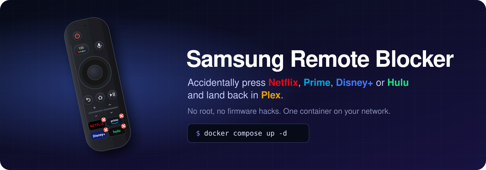
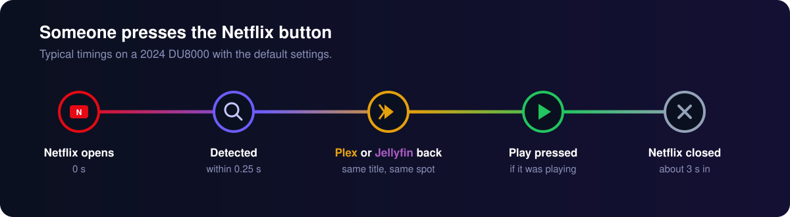
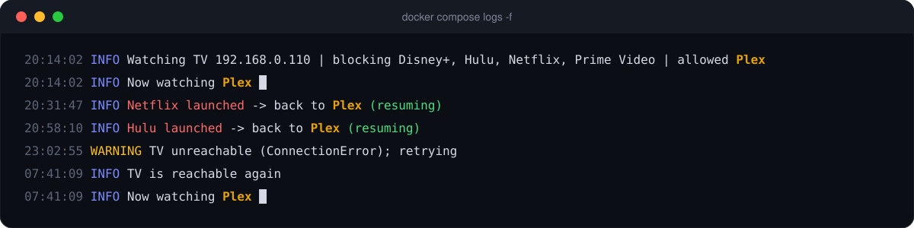
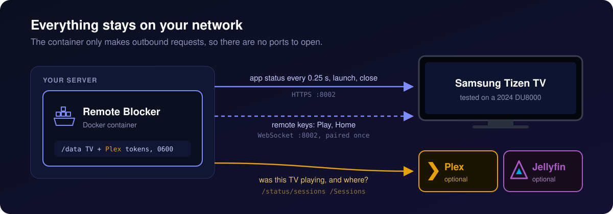

<p align="center">
  
</p>

<p align="center">
  <a href="https://github.com/cpeoples/samsung-remote-blocker/actions/workflows/ci.yml"></a>
  <a href="https://github.com/cpeoples/samsung-remote-blocker/pkgs/container/samsung-remote-blocker"></a>
  <a href="https://hub.docker.com/r/cpeoples/samsung-remote-blocker"></a>
  
  
  <a href="LICENSE"></a>
</p>

Samsung remotes have Netflix, Prime Video, Disney+, Hulu and YouTube buttons that a kid, a guest, or the couch cushion will press in the middle of your movie. Samsung Remote Blocker watches the TV from a server on your network. When a blocked app opens, it puts you back where you were, presses Play if something was playing, and closes the blocked app.

It doesn't root the TV or install anything on it; it only talks to the TV's local network API.

<p align="center">
  
</p>

> [!NOTE]
> Tizen has no way to truly disable the buttons, so the blocked app is on screen for a moment before it's closed. Tested on a 2024 UN65DU8000FXZA; Samsung changes these APIs between model years, so [reports for other models](../../issues) are welcome.

## Quick start

You need Docker with Compose v2 on a machine on the same network as the TV. Give the TV a DHCP reservation in your router so its IP doesn't change.

```bash
mkdir samsung-remote-blocker && cd samsung-remote-blocker
curl -fsSLO https://raw.githubusercontent.com/cpeoples/samsung-remote-blocker/main/docker-compose.yml
curl -fsSL -o .env https://raw.githubusercontent.com/cpeoples/samsung-remote-blocker/main/.env.example
```

**Find the TV.** This lists every Samsung TV with its name, model and MAC, so you can tell several apart. Put its IP in `.env` as `TV_IP`, or pass it inline as `TV_IP=192.168.0.110 docker compose ...`.

```bash
docker compose run --rm blocker discover --scan 192.168.0.0/24
```

**Optional: Plex auto-resume.** Set `PLEX_URL` in `.env`, then link a token at [plex.tv/link](https://plex.tv/link) using the code this prints (see [Plex token](#plex-token)):

```bash
docker compose run --rm blocker plex-login
```

**Start it, then press Allow on the TV.** The first time the blocker reaches the TV it asks to pair; the TV shows an Allow prompt for 60 seconds. If nobody answers, blocking still works, and it asks again the next time the TV comes on. The token is saved in the `data` volume. (`docker compose run --rm blocker pair` does the same thing by hand.)

```bash
docker compose up -d && docker compose logs -f
```

<p align="center">
  
</p>

To update: `docker compose pull && docker compose up -d`.

## How it works

<p align="center">
  
</p>

Every 0.25 s the blocker asks the TV which apps are on screen, and remembers the last allowed one. When a blocked app shows up, it launches the allowed app again, or goes Home if there wasn't one. If Plex reported this TV as playing in the last few seconds, it presses Play. Then it closes the blocked app.

When the TV is off, the blocker logs it once and keeps retrying, then picks up where it left off when the TV comes back.

## Configuration

Everything is an environment variable, set in `.env`, in the shell, or in the stack file. Values are checked at startup, and a bad one stops the container with a message saying which.

| Variable | Default | |
|---|---|---|
| `TV_IP` | **required** | The TV's IP address. It must be an IP, since Plex identifies the TV by IP |
| `BLOCKED_APPS` | `netflix,disney,prime,hulu,youtube` | Slugs from [`apps.json`](samsung_remote_blocker/apps.json) or raw `id:Name` pairs |
| `ALLOWED_APPS` | `plex` | Apps to return to, same format |
| `PLEX_URL` | | e.g. `http://192.168.0.20:32400`. Without it, Plex comes back but isn't resumed |
| `PLEX_TOKEN` | | See [Plex token](#plex-token) |
| `PLEX_TOKEN_FILE` | `/data/.plex-token` | Where the Plex token is read from and where `plex-login` saves it |
| `PLEX_PREFERENCES` | | Path to a Plex Media Server `Preferences.xml` |
| `POLL_SECONDS` | `0.25` | TV poll interval. Lower means a shorter flash and more requests |
| `PLEX_POLL_SECONDS` | `1` | Plex poll interval while Plex is in front |
| `RESUME_WINDOW` | `3` | Resume if Plex was playing within this many seconds |
| `RESUME_DELAY` | `2` | Wait before the first Play press. Play is repeated until Plex reports playback |
| `RESUME` | `true` | `false` brings Plex back without pressing Play |
| `TZ` | UTC | Time zone for log timestamps, e.g. `America/New_York` |
| `LOG_LEVEL` | `info` | `debug` adds what Plex reported while resuming |
| `DATA_DIR` | `/data` in Docker, `.` otherwise | Where tokens are stored |
| `PUID` / `PGID` | owner of `PLEX_PREFERENCES`, else `1000` | User the container runs as. Rarely needed; see [Permissions](#permissions) |

### Plex token

The token is optional. Without it the blocker still kicks out blocked apps and brings Plex back; it just can't tell whether something was playing, so it doesn't press Play.

The easiest way to get one is `plex-login`, run once. It prints a 4-character code; enter it at [plex.tv/link](https://plex.tv/link) from any phone or browser signed in to the Plex account that owns the server. The token is saved in the `data` volume, so there's nothing to copy and nothing to pass when starting the container. Your password is never involved, and the token shows up as a "samsung-remote-blocker" device in your Plex account, where you can revoke it. If you do, the logs say so and you run `plex-login` again.

The token can also come from these sources, checked in this order:

| Source | When to use it |
|---|---|
| `PLEX_TOKEN` | Quick tests. Anyone who can run `docker inspect` on the host can read it |
| `PLEX_TOKEN_FILE` | You already have a token. Point it at a [Compose secret](https://docs.docker.com/compose/how-tos/use-secrets/) in `/run/secrets/`; see [`stack.example.yml`](stack.example.yml) |
| `PLEX_PREFERENCES` | The blocker runs on the same host as Plex Media Server. Mount its config folder read-only (see `docker-compose.yml`); mount the folder rather than the file, because Plex replaces the file when it saves. That token has the server owner's full rights, so prefer `plex-login` |

<details>
<summary><b>Full stack file, or plain <code>docker run</code></b></summary>

[`stack.example.yml`](stack.example.yml) spells out every setting inline instead of using `.env`, which suits Portainer and similar UIs. The image is on both GHCR and Docker Hub; `cpeoples/samsung-remote-blocker` works anywhere `ghcr.io/cpeoples/samsung-remote-blocker` does.

In Portainer, paste it under **Stacks › Add stack › Web editor**, deploy, and press Allow on the TV when it asks. Nothing needs to be run in a console.

**More than one TV:** run one blocker per TV, each with its own `TV_IP`. They can share the `data` volume; pairing tokens are stored per TV.

```yaml
services:
  living-room:
    image: cpeoples/samsung-remote-blocker:latest
    restart: unless-stopped
    environment: {TV_IP: 192.168.0.110, PLEX_URL: "http://192.168.0.20:32400"}
    volumes: [data:/data]
  bedroom:
    image: cpeoples/samsung-remote-blocker:latest
    restart: unless-stopped
    environment: {TV_IP: 192.168.0.111, PLEX_URL: "http://192.168.0.20:32400"}
    volumes: [data:/data]
volumes:
  data:
```

Without Compose:

```bash
docker volume create srb-data
docker run --rm -it -e TV_IP=192.168.0.110 -v srb-data:/data ghcr.io/cpeoples/samsung-remote-blocker pair
docker run --rm -it -v srb-data:/data ghcr.io/cpeoples/samsung-remote-blocker plex-login
docker run -d --name samsung-remote-blocker --restart unless-stopped \
  -e TV_IP=192.168.0.110 -e PLEX_URL=http://192.168.0.20:32400 \
  -v srb-data:/data ghcr.io/cpeoples/samsung-remote-blocker
```

</details>

<details>
<summary><b>Commands</b></summary>

The image's entrypoint is the CLI, so `docker compose run --rm blocker <command>` runs any of these:

| Command | |
|---|---|
| `watch` | Run the blocker (default) |
| `pair` | Pair with the TV now instead of waiting for the blocker to ask |
| `discover [--scan CIDR] [--json]` | Find Samsung TVs. Without `--scan` it uses SSDP, which needs `network_mode: host` in Docker |
| `app <id-or-slug>...` | Show an app's status, e.g. `app netflix 3201512006963` |
| `apps` | List installed apps (some firmware never answers) |
| `key <KEY>` | Send one remote key, e.g. `key KEY_PLAY` |
| `plex-login` | Get a Plex token via plex.tv/link |

Add `-v` before the command for debug logging, or set `LOG_LEVEL=debug` in the stack for the running blocker. Don't run `watch` from a console while the container is running; two watchers will both react to every button. `--version` prints the version.

</details>

<details>
<summary><b>Running without Docker</b></summary>

With Python 3.10 or newer:

```bash
python3 -m venv .venv
.venv/bin/pip install .
export TV_IP=192.168.0.110
.venv/bin/samsung-remote-blocker pair
.venv/bin/samsung-remote-blocker
```

Tokens go in the current directory unless `DATA_DIR` is set.

</details>

## Supported apps

| Slug | App | Verified on |
|---|---|---|
| `netflix` | Netflix | UN65DU8000FXZA |
| `prime` | Prime Video | UN65DU8000FXZA |
| `disney` | Disney+ | UN65DU8000FXZA |
| `hulu` | Hulu | UN65DU8000FXZA |
| `youtube` | YouTube | UN65DU8000FXZA |
| `plex` | Plex | UN65DU8000FXZA |

Any other app works by ID, e.g. `BLOCKED_APPS=netflix,3201234567890:Some App`. To add an app to the list, or to verify one on your model:

1. Check the ID on your TV with `app <id>`. A status with the expected `name` confirms it; `not installed` means that ID doesn't exist on your TV.
2. Add it to [`apps.json`](samsung_remote_blocker/apps.json), mapping each ID to the models it was verified on. IDs vary by region, so an app can list several; the ones a TV doesn't have are ignored after the first poll.

   ```json
   "hulu": {"name": "Hulu", "ids": {"3201601007625": ["UN65DU8000FXZA"]}}
   ```

3. Open a pull request.

## Troubleshooting

<details>
<summary><b>No Allow prompt, or pairing was denied</b></summary>

The prompt only shows while the TV is on. If you missed it, the blocker asks again the next time the TV comes on, or run `pair` to ask now. If it was denied, remove the device under **Settings › General › External Device Manager › Device Connection Manager › Device List** and restart the container.

</details>

<details>
<summary><b>Plex comes back paused</b></summary>

If the log line doesn't end in `(resuming)`, Plex playback wasn't detected. Check that `PLEX_URL` and the token are set, and that the Plex session's player address matches `TV_IP`:

```bash
curl -s -H 'Accept: application/json' -H "X-Plex-Token: $PLEX_TOKEN" "$PLEX_URL/status/sessions" \
  | jq '.MediaContainer.Metadata[].Player | {address, state}'
```

If it says `(resuming)` but stays paused, the log also says `Plex didn't resume`. Check that `key KEY_PLAY` works by hand, then raise `RESUME_DELAY`. `LOG_LEVEL=debug` shows what Plex reported after each press. To turn resuming off, set `RESUME=false`.

</details>

<details>
<summary><b>"TV unreachable" in the logs</b></summary>

This is expected while the TV is off. The blocker keeps polling and logs when the TV is back.

</details>

<details>
<summary><b>Permission denied on <code>/data</code> or <code>Preferences.xml</code></b></summary>

<a id="permissions"></a>The container starts as root only to `chown` `/data`, then switches to the user that owns `Preferences.xml` (so it can read the Plex token), or to `1000:1000`. Named volumes and bind-mounted folders both work without setup.

To pick the user yourself, set `PUID` and `PGID`. If you set `user:` in the stack, nothing is changed: `/data` must already be writable by that user, and the log says so if it isn't.

</details>

## Limitations

- It's not a true disable; the blocked app is visible for a moment.
- Samsung TV Plus is built into the TV and doesn't show up in the applications API (none of the published IDs answer on a DU8000), so its button can't be blocked yet. If you find an ID that works with `app <id>`, please open an issue.
- HDMI inputs and live TV aren't apps, so there's nothing to return to; the blocker goes Home.
- Auto-resume supports Plex only.

## Security

- The TV pairing token lets anything that has it control the TV, and the Plex token grants access to your Plex account. Both live in the `data` volume (or `DATA_DIR`) with mode `0600`, and are excluded by `.gitignore` and `.dockerignore`.
- The container switches from root to an unprivileged user before connecting to anything, and needs no inbound ports.
- The TV uses a self-signed certificate, so verification is disabled for TV requests only. Plex and plex.tv requests are verified.
- The Plex token is sent as a header, never in URLs.

## Development

```bash
python3 -m venv .venv && .venv/bin/pip install -e . ruff==0.17.4 "coverage[toml]>=7.5"
.venv/bin/ruff check . && .venv/bin/ruff format --check .
.venv/bin/coverage run -m unittest discover -s tests && .venv/bin/coverage report
docker build -t ghcr.io/cpeoples/samsung-remote-blocker:dev .
```

Every pull request must pass the same checks CI runs ([`ci.yml`](.github/workflows/ci.yml)):

| Check | Fails when |
|---|---|
| `ruff check` | Lint errors or unsorted imports |
| `ruff format --check` | Code isn't formatted; run `ruff format .` |
| Unit tests, Python 3.10 and 3.13 | Any test fails; no TV or network needed |
| Coverage | Line and branch coverage drops below 85% |
| `apps.json` rules ([`test_registry.py`](tests/test_registry.py)) | Bad slug, malformed or duplicate ID, an ID under two apps, or a malformed model number |
| Image build, amd64 and arm64 | The Dockerfile doesn't build or the CLI doesn't start |

Pushes to `main` publish `linux/amd64` and `linux/arm64` images to `ghcr.io/cpeoples/samsung-remote-blocker` and `docker.io/cpeoples/samsung-remote-blocker` as `:edge`. A tag such as `v0.2.0` publishes `:0.2.0`, `:0.2` and `:latest`; keep it in sync with `version` in `pyproject.toml`. GHCR uses the workflow's built-in token; Docker Hub needs the `DOCKERHUB_USERNAME` and `DOCKERHUB_TOKEN` (Read & Write PAT) repository secrets. GHCR makes new packages private, so after the first push, set the package to public under **Package settings › Change visibility**.

---

<sub>Not affiliated with or endorsed by Samsung, Plex, Netflix, Amazon, Disney, Hulu or Google. App names identify the buttons being blocked; the remote in the banner is an illustration.</sub>
